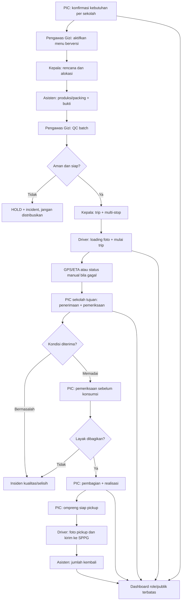

# Alur Bisnis Existing, Usulan dan Batas Peran

## 1. Fakta vs ilustrasi
Juknis dan dokumentasi SIPGN menunjukkan kegiatan melibatkan SPPG, ahli gizi, operasional produksi, distribusi, PIC penerima, bukti dan kontrol. **Alur manual existing di bawah adalah rekonstruksi untuk analisis**, bukan hasil observasi lapangan langsung pada SPPG tertentu. Untuk laporan dosen, sebutkan secara jujur sebagai baseline hipotetis yang perlu divalidasi lewat wawancara.

## 2. Baseline existing (untuk wawancara)
1. Sekolah menyampaikan kebutuhan melalui kanal yang tersedia; staf SPPG merangkum per sekolah.
2. Pengelola dan ahli gizi memilih menu, target dan pembagian produksi.
3. Dapur mempersiapkan, memasak, memorsikan dan mengemas makanan.
4. Petugas memuat dan mengirim ke satu atau beberapa sekolah sesuai rute.
5. Sekolah memeriksa jumlah dan kondisi, lalu mencatat penerimaan/pembagian.
6. Wadah/ompreng dikumpulkan, diambil dan dikembalikan ke SPPG.
7. Kepala merekap kondisi, keterlambatan dan masalah.

**Hipotesis masalah bila sistem tidak tersambung:** data ganda, informasi antar-sekolah bercampur, status tidak memiliki pembuktian, komplain tidak terlacak; **bukan** tuduhan semua SPPG saat ini bekerja manual.

## 3. Alur usulan sistem end-to-end

## 4. Status per sekolah, bukan status global
SPPG → trip 1 → stop SD A diterima, stop SD B sedang menuju, stop SMP C menunggu. Timestamp per stop; publik hanya menampilkan status terkait sekolah yang dipilih. Jangan tandai seluruh trip selesai ketika hanya stop pertama selesai.

## 5. Foto bukti pada titik tanggung jawab
- Asisten: makanan siap/selesai packing (`FOOD_READY`).
- Driver/Asisten: muatan telah masuk kendaraan (`VEHICLE_LOADED`).
- Driver menyerahkan + PIC menyetujui **satu transaksi bersama** (`SCHOOL_HANDOVER`); foto tambahan hanya untuk selisih.
- PIC: ompreng siap dijemput (`TRAYS_READY`).
- Driver: ompreng diambil (`TRAYS_PICKED_UP`).
- Asisten: cocokkan jumlah saat balik; foto problem bila selisih.
Foto bukan sertifikat higienitas; pemeriksaan kondisi tetap dilakukan orang berwenang.

## 6. Exception gate
Tidak ada porsi dikonfirmasi → jangan tebak angka; menu tidak aktif → plan tidak difinal; batch QC hold → tidak dikirim; receipt belum disahkan PIC → status belum diterima; QC sebelum makan gagal → jangan dibagikan; GPS hilang → perjalanan fisik tetap dapat dilaporkan manual dengan label stale; ompreng kurang → discrepancy dan incident.

## 7. Rujukan
- [BGN Juknis 2026](https://cdn-web.bgn.go.id/juknis/01KFZQGR85YKY1HRMNDK4RRM1P.pdf)
- [POP SIPGN](https://portal-doc-sipgn.bgn.go.id/panduan-sipgn/produksi/pop)
- [Penerima Manfaat SIPGN](https://portal-doc-sipgn.bgn.go.id/panduan-sipgn/penerima-manfaat/penerima-manfaat)

## Swimlane implementasi — proses utuh satu hari
| Tahap | PIC sekolah | Kepala SPPG | Gizi | Asisten | Kurir | Sistem |
|---|---|---|---|---|---|---|
| H-1/H-0 request | konfirmasi kebutuhan agregat | lihat pending | — | — | — | cutoff/lock/revision history |
| menu | lihat menu | tinjau | susun versi/approve | — | — | snapshot version ke plan |
| plan | — | alokasi & finalisasi | tahu jadwal QC | lihat target | — | cek kapasitas & total |
| produksi | — | monitor exception | — | tahap & bukti siap | — | log stage+batch actual |
| QC | — | monitor HOLD | pemeriksaan manual | koreksi proses bila perlu | — | release gate/incident |
| loading/trip | — | assign | — | manifest muatan & bukti | vehicle check/start | collision/quantity guard |
| perjalanan | lihat status relevan | lihat semua trip tenant | — | — | GPS saat foreground | dedupe ETA notif & stale |
| serah terima | hitung/cek kualitas | monitor | lihat temuan | — | bukti handover | reconcile, incident |
| makan | uji lagi, distribusi | monitor | kualitas | — | — | no serve if unsafe |
| wadah | hitung & tandai ready | jadwalkan | — | terima balik | pickup | selisih wadah/audit |
| publik | — | — | — | — | — | projection aman sekolah/tanggal |

### Boundary ownership
- Kepala **merencanakan dan mengesahkan**; tidak boleh diam-diam mengakui receipt sekolah.
- Pengawas Gizi memutuskan hasil pemeriksaan kualitas; aplikasi tidak menginfer SAFE dari foto.
- Asisten mencatat aktual produksi; driver mencatat aksi fisik trip; PIC mencatat penerimaan dan makan.
- Sistem menghitung nilai turunan dan membuat notifikasi, tetapi bukan aktor yang melakukan serah terima atau makan.

### Jalur exception utama
`QC UNSAFE → ON_HOLD → incident → tidak boleh load`; `trip interrupted → kepala reschedule/driver change dengan audit`; `PIC receive short/over → reconciliation + incident`; `GPS stale → ETA unavailable, manual handling tetap mungkin`; `school closed → stop exception, jangan auto COMPLETED`; `tray partial → status tetap open sampai kembali/penutupan beralasan`.

## V3 | Content-driven route and UI
Layout mengikuti arus fakta: kebutuhan agregat PIC→allocation→actual production→QC→trip→handover→consumption→trays. Setiap transisi UI harus menunjuk state server yang benar; antislop R-17/38 melarang memasukkan dummy statistik atau foto untuk mengganti data yang belum tersedia. Produksi dummy sebaiknya kosong jujur; DEMO fixture terpisah.
