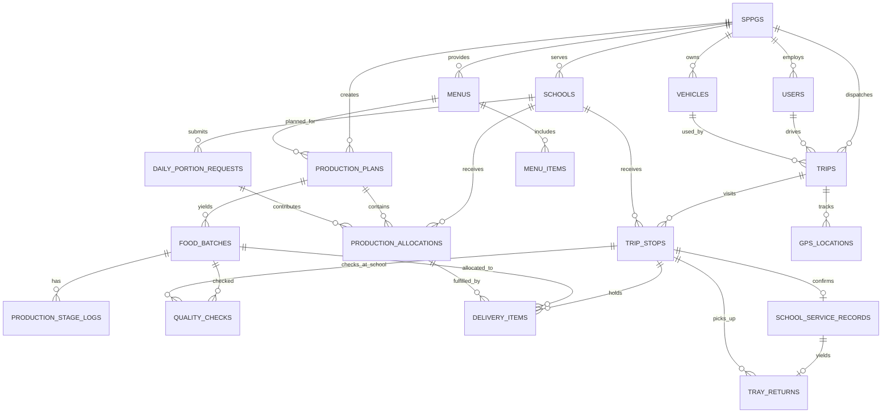
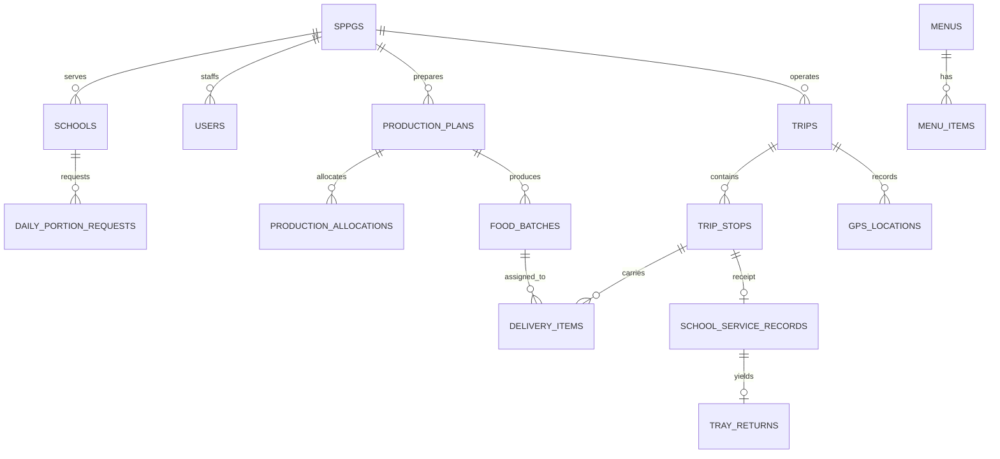

# ERD v1.1 — Relasi yang Dapat Diimplementasikan

> Disusun dari ERD percakapan v1.0; v1.1 menyelesaikan ambiguitas: `trip_stops.stop_type`, `tray_returns.ready_count`, relasi many-to-many batch → sekolah melalui `delivery_items`, `quality_checks` sebagai pemeriksaan batch maupun di sekolah. Sebelum produksi, review bersama migration dan unit test. Bukan ERD resmi BGN.

## Diagram inti

## Kunci desain
- SPPG 1:N schools/users/trips; PIC adalah user yang school_id mengacu sekolah. SPPG PIC diturunkan dari school.sppg_id, bukan dipercaya dari query.
- Menu berbasis versi; setiap plan menunjuk satu versi menu pada skenario MVP. Jika satu sekolah butuh menu khusus pada hari sama, perlu rancangan perubahan terkontrol sebelum menambah tabel.
- `daily_portion_requests`: unique(school_id, service_date). Snapshot jumlah saat konfirmasi; revisi diaudit.
- `production_plans` 1:N `production_allocations` per sekolah; sumber numerik bukan double input.
- `food_batches` adalah hasil produksi, bisa terpisah porsi; `quality_checks` mengatur release.
- `trip_stops` per pengantaran/pickup; unik(trip_id, sequence_number). Boleh sekolah yang sama muncul di trip delivery dan pickup terpisah.
- `delivery_items` mengaitkan stop, batch, dan alokasi: satu batch → banyak stop; satu stop → banyak batch. Ini menghilangkan kesalahan awal yang mengasumsikan satu stop hanya satu batch.
- `school_service_records` maksimum satu record pada **delivery** trip_stop; perlu test stop_type DELIVERY. Bukti foto reference ke service/stop sesuai checkpoint.
- `tray_returns` terhubung serah-terima, bisa punya **pickup** stop lain. Jumlah siap/diambil/kembali tidak diasumsikan sama.
- `gps_locations` disimpan per trip, bukan posisi user permanen; `evidence_photos` polymorphic dengan policy parent.
- `activity_logs` bersifat append-only. Notification bawaan Laravel memakai UUID id.

## Tradeoff sengaja
22 tabel domain dan infrastruktur adalah estimasi wajar untuk scope; jangan menambah tabel tanpa kebutuhan query atau invariant yang gagal. Untuk produksi nyata, mungkin butuh batch-menu multi-type, audit revisi detail, item return, tenancy lebih ketat, compliance tambahan; itu bukan klaim selesai untuk produksi nasional.

## Gap yang wajib diuji sebelum migration pertama
1. Bagaimana pengalokasian sekolah dengan dua jenis porsi pada hari sama? MVP satu menu versi per plan, kategori porsi pada batch, dengan eksplisit flag change request bila butuh lebih.
2. Bagaimana menghindari `delivery_items` sum loaded melebihi actual_portions per batch? Service transaction + aggregate locks.
3. Bagaimana menangani dua trip pada sekolah sama di hari sama? Rekam stop per trip; service record per delivery stop; dashboard agregat per school/date tanpa assume unik school/day.
4. Bagaimana memverifikasi quality check stage tidak dipalsukan? Role + stage transition + timestamp server; kesimpulan masih penilaian manusia.
5. Relasi polymorphic ditangani aplikasi; database tak bisa FK ke semua parent morph otomatis, sehingga lifecycle orphan perlu tes.

## Rujukan lanjutan
`DATA-DICTIONARY.md`, `ROLE-PERMISSION-MATRIX.md`, `STATUS-WORKFLOWS.md`.

## Relasi v2 yang rawan salah implementasi
- `sppgs 1:N schools/users/vehicles/plans/trips`; `schools 1:N portion_requests/trip_stops`.
- `menus 1:N menu_items`; identitas versi **bukan** update baris yang sudah aktif dipakai produksi. Unique `(sppg_id,menu_code,version)`.
- `production_plans 1:N allocations/batches`, `production_allocations N:1 school` dan `N:1 request`. Permintaan porsi dapat dirujuk lebih dari satu plan **hanya jika alokasi total seluruh plan dikelola**; jangan double count request sekolah bila beberapa menu.
- `trip_stops 1:N delivery_items`; `food_batches 1:N delivery_items`; ini menjadikan hubungan batch dan stop banyak-ke-banyak yang benar.
- `school_service_records 1:1 trip_stops` **khusus stop DELIVERY**, tidak otomatis dibuat pada stop PICKUP; jika sekolah menerima dua delivery dalam sehari ada dua service record, laporan harian harus agregasi dengan benar.
- `tray_returns 1:1 school_service_records` pada MVP artinya satu return lifecycle per service; **partial pickup multi-kurir berulang tidak didukung sebagai banyak baris detail**. Jika kebutuhan lapangan menuntut banyak pickup, buat decision log dan desain child pickup events sebelum migration, jangan memaksa satu kolom di-overwrite.
- `quality_checks` checkpoint batch + trip_stop; stage menentukan kunci yang harus non-null. `evidence_photos/incidents/activity_logs` polymorphic tidak menghasilkan FK secara otomatis, whitelist morph types dan policy.

### Diagram relasi ringkas

### Peringatan implementasi
ERD konseptual ini tidak menggantikan migration test; FK individu tidak menjamin konsistensi tenant di seluruh jalur join. Perlu policy scope dan aggregate validation. Jangan menyatakan sistem menjamin pembatasan SPPG bila test lintas tenant belum lulus.

## V3 | Data-display integrity check
Anti-slop tidak mengubah cardinality/ERD yang sudah disepakati. Tetapi seluruh KPI dan label halaman harus di-map ke field yang akurat; `school.registered_beneficiaries` tidak membuktikan porsi harian, one trip may serve many stops, one batch may split to many stops via delivery items. Gunakan table projection terikat scope tenant dan jangan hardcode metric di Blade.
