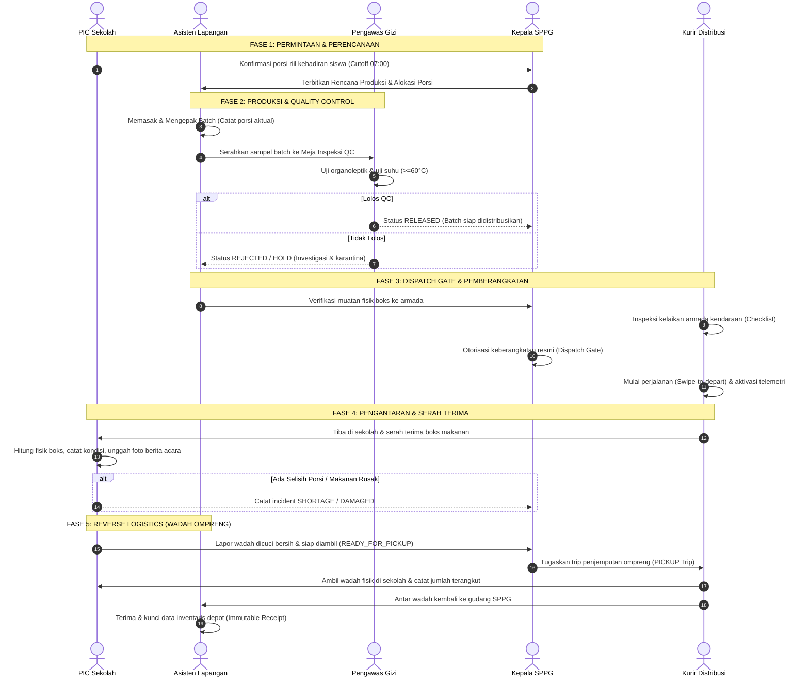

<div align="center">

# 🍱 MBG-Track
### Sistem Monitoring Distribusi & Logistik Balik Program Makan Bergizi Gratis

*Arsitektur Modular Monolith &bull; Calm Operational Editorial Design &bull; Server-Authoritative Chain of Custody &bull; Aksesibilitas WCAG 2.2 AA*

<br/>

[](https://php.net)
[](https://laravel.com)
[](https://mysql.com)
[](https://tailwindcss.com)
[](file:///P:/Tugas%20PPL%20MBG/tests)
[](file:///P:/Tugas%20PPL%20MBG/tests/js)
[](#-cakupan-12-product-backlog-items-pbi)
[](LICENSE)

<br/>

**[Jelajahi Fitur](#-cakupan-12-product-backlog-items-pbi)** &bull;
**[Alur Operasional](#-siklus-operasional-rantai-pasok)** &bull;
**[Matriks Peran](#-matriks-peran--ruang-kerja)** &bull;
**[Panduan Instalasi](#-panduan-instalasi--menjalankan-aplikasi)** &bull;
**[Kredensial Demo](#-kredensial-pengujian--akun-demo)**

</div>

---

## 📖 Tentang MBG-Track

**MBG-Track** adalah platform operasional terpadu yang dirancang untuk mengawal transparansi, akuntabilitas, dan keamanan pangan dalam ekosistem **Program Makan Bergizi Gratis (MBG)**. 

Platform ini menjembatani seluruh simpul rantai pasok: mulai dari penetapan kuota sekolah, formulasi menu bersertifikasi gizi, eksekusi dapur produksi, kontrol kualitas (*QC Gate*), pergerakan armada berizin, serah terima berbukti digital, hingga **logistik balik wadah ompreng (*reverse logistics*)** dan transparansi publik.

```
       [SEKOLAH]                     [DAPUR SPPG]                   [LOGISTIK]                  [SERAH TERIMA]
 Konfirmasi Kebutuhan Porsi  ──▶  Perencanaan & Produksi  ──▶  Pemeriksaan Kualitas (QC)  ──▶  Inspeksi & Dispatch
      (PIC Sekolah)                   (Asisten Dapur)               (Pengawas Gizi)               (Kepala SPPG)
                                                                                                        │
                                                                                                        ▼
       [REVERSE LOGISTICS]           [PELACAKAN PUBLIK]             [PENERIMAAN GUDANG]          [DISTRIBUSI KURIR]
 Penjemputan Wadah Ompreng   ◀──   Estimasi Kedatangan    ◀──   Penerimaan Fisik Depot    ◀──  Navigasi Berizin &
      (D05 / K05 / A03)            Publik Tanpa GPS Privat            (Asisten Lapangan)           Bukti Serah Terima
```

---

## 🌟 Nilai Utama Arsitektur

| Pilar | Penerapan dalam MBG-Track |
|---|---|
| **Server-Authoritative Custody** | Validasi rantai kepemilikan mutlak di server. Pengemudi tidak dapat mengubah muatan sepihak, dan kuantitas penerimaan gudang depot bersifat *immutable* setelah diverifikasi. |
| **Multi-Tenant Scope Security** | Isolasi data ketat per Satuan Pelayanan Pemenuhan Gizi (SPPG) dan Sekolah. Mencegah kebocoran data sensitif anak dan melindungi kerahasiaan telemetri koordinat kurir. |
| **Strict Dispatch Gate Invariant** | Keberangkatan armada mewajibkan 5 gerbang kelolosan: (1) Menu & Batch Lolos QC, (2) Muatan Fisik Diverifikasi, (3) Inspeksi Keselamatan Kendaraan, (4) Pengesahan Kepala SPPG, dan (5) Konfirmasi Kurir Aktif. |
| **Reverse Logistics Traceability** | Siklus hidup wadah ompreng terlacak menyeluruh (`IN_USE` &rarr; `READY_FOR_PICKUP` &rarr; `PICKUP_ASSIGNED` &rarr; `PICKED_UP` &rarr; `RETURNED_TO_SPPG`). Selisih wadah otomatis memicu penerbitan tiket insiden. |
| **Calm Operational Editorial** | Antarmuka didesain berbasis *high cognitive load reduction*: kontras rasio tinggi (WCAG 2.2 AA), sentuhan responsif minimal 44&times;44px, bebas animasi dekoratif berlebih, dan reflow mulus di layar 390px (mobile) hingga 1440px (desktop). |

---

## 👥 Matriks Peran & Ruang Kerja

MBG-Track menerapkan kontrol akses berbasis peran (*Role-Based Access Control*) yang presisi untuk 5 peran operasional internal dan 1 portal publik:

```
┌────────────────────────────────────────────────────────────────────────────────────────┐
│                                   PORTAL PUBLIK (U01-U04)                              │
│         Pencarian Sekolah • Menu Hari Ini • Kandungan Gizi • Estimasi Pengiriman        │
└───────────────────────────────────────────┬────────────────────────────────────────────┘
                                            │
                    ┌───────────────────────┴───────────────────────┐
                    │                                               │
      ┌─────────────▼─────────────┐                   ┌─────────────▼─────────────┐
      │   INTERNAL SPPG OPERATOR  │                   │     SEKOLAH PENERIMA      │
      ├───────────────────────────┤                   ├───────────────────────────┤
      │ • KEPALA_SPPG      (K01)  │                   │ • PIC_SEKOLAH      (P01)  │
      │ • PENGAWAS_GIZI    (G02)  │                   │   - Konfirmasi Porsi      │
      │ • ASISTEN_LAPANGAN (A02)  │                   │   - Penerimaan Berita Acara│
      │ • KURIR            (D01)  │                   │   - Laporan Wadah Bersih  │
      └───────────────────────────┘                   └───────────────────────────┘
```

### 1. 👑 Kepala SPPG (`KEPALA_SPPG`)
*Ruang Kontrol Utama & Manajemen Unit Operasional*
- **[K01] Dashboard Operasional:** Pemantauan kendala mendesak, exception porsi, dan progres harian lintas sekolah.
- **[K03] Manajemen Pegawai:** Penatausahaan akun internal, hak akses peran, serta penugasan pengawas dan kurir.
- **[K04] Perencanaan Produksi:** Penetapan target batch, alokasi sekolah, persetujuan revisi dispensasi porsi darurat.
- **[K05] Kontrol Distribusi & Logistik Balik:** Penugasan rute armada (*Delivery / Pickup / Mixed*), pengesahan keberangkatan (*Dispatch Gate*), penugasan kurir jemput ompreng, dan pelacakan armada real-time.
- **[K06] Laporan & Audit:** Rekapitulasi histori porsi harian, audit trail waktu, dan kepatuhan pengiriman.

### 2. 🥗 Pengawas Gizi (`PENGAWAS_GIZI`)
*Penjamin Mutu, Nutrisi, dan Kelaikan Konsumsi*
- **[G02] Siklus Menu & AKG:** Formulasi menu seimbang dengan perhitungan Angka Kecukupan Gizi (energi, protein, lemak, karbohidrat), alergen pangan, serta siklus menu mingguan.
- **[G03] Quality Control (QC Gate):** Uji organoleptik batch masak (rasa, aroma, tekstur, suhu &ge;60&deg;C), dokumentasi foto sampel, dan penerbitan status *RELEASED* atau *REJECTED/HOLD*.

### 3. 🍳 Asisten Lapangan (`ASISTEN_LAPANGAN`)
*Pelaksana Produksi Dapur & Penerimaan Fisik Gudang*
- **[A02] Eksekusi Batch Dapur:** Manajemen tahapan memasak (*PREPARATION* &rarr; *COOKING* &rarr; *PACKING*), pencatatan porsi riil, dan penyerahan ke meja inspeksi QC.
- **[A03] Logistik Muatan & Retur Ompreng:** Verifikasi fisik jumlah boks ke dalam kendaraan kurir serta penerimaan dan inventarisasi wadah ompreng yang kembali dari sekolah di gudang SPPG.

### 4. 🚚 Kurir Distribusi (`KURIR`)
*Operasional Armada Lapangan & Logistik Balik*
- **[D02] Pemeriksaan Kendaraan:** Inspeksi pra-jalan (rem, ban, bahan bakar, kebersihan boks kargo).
- **[D03] Navigasi Aktif & Telemetri:** Perjalanan rute dinamis, update titik perhentian sekolah (*En Route / Arrived*), dan transmisi koordinat GPS berizin.
- **[D04] Serah Terima Sekolah:** Konfirmasi serah terima boks makanan, unggah foto bukti serah terima, dan pencatatan kondisi awal.
- **[D05] Penjemputan Ompreng:** Eksekusi tugas penjemputan wadah di sekolah, verifikasi jumlah fisik wadah bersih, dan pelaporan selisih wadah hilang/rusak.

### 5. 🏫 PIC Sekolah (`PIC_SEKOLAH`)
*Verifikator Sekolah Penerima Manfaat*
- **[P01] Dashboard Layanan:** Jadwal pengiriman hari ini, menu anak, dan kontak darurat SPPG.
- **[P02] Konfirmasi Porsi Harian:** Input kehadiran siswa riil harian dan pengajuan dispensasi/perubahan porsi sebelum batas waktu (*cutoff*).
- **[P03] Lacak Pengantaran:** Monitoring status kurir menuju sekolah tanpa mengekspos rute personal pengemudi.
- **[P04] Pemeriksaan & Berita Acara Penerimaan:** Verifikasi fisik boks makanan diterima, pencatatan porsi rusak/kurang, tanda tangan digital penerima, dan unggah foto bukti.
- **[P06] Kesiapan Wadah Ompreng:** Pelaporan wadah ompreng yang telah dicuci bersih dan siap dijemput oleh kurir.

### 6. 🌐 Transparansi Publik (Tanpa Login)
*Keterbukaan Informasi Publik bagi Keluarga Siswa & Masyarakat*
- **[U01] Cari Sekolah:** Direktori pencarian sekolah penerima manfaat MBG di seluruh wilayah operasional.
- **[U02] Menu & Tahapan Hari Ini:** Rincian menu makanan hari ini, foto hidangan, dan status tahapan penyaluran.
- **[U03] Informasi Komponen Gizi:** Komposisi nutrisi terperinci yang telah disahkan oleh Pengawas Gizi.
- **[U04] Status Pengiriman Publik:** Indikator status kedatangan makanan berbasis waktu dan zona tanpa membuka privasi lokasi presisi pengemudi.

---

## 📋 Cakupan 12 Product Backlog Items (PBI)

Seluruh 12 Product Backlog Items telah selesai diimplementasikan, diuji, dan dinyatakan lolos Delivery Gate:

| Kode | Modul Fungsional | Deskripsi & Cakupan Teknis | Status |
|:---:|---|---|:---:|
| **PBI-01** | Data Induk Sekolah & Kuota | Pengelolaan sekolah mitra, kuota dasar penerima, koordinat geolokasi, dan PIC resmi. | ✅ Lolos |
| **PBI-02** | Akun & Autorisasi Staf | Manajemen pegawai SPPG, isolasi role 5 tingkat, dan audit trail sesi pengguna. | ✅ Lolos |
| **PBI-03** | Menu & Standar Nutrisi | Siklus menu, verifikasi AKG, sertifikasi kelaikan gizi, dan riwayat revisi resep. | ✅ Lolos |
| **PBI-04** | Konfirmasi Porsi Harian | Penguncian porsi harian oleh sekolah, pengajuan revisi darurat, dan rekonsiliasi kuota. | ✅ Lolos |
| **PBI-05** | Perencanaan Batch Produksi | Penjadwalan rencana dapur harian, alokasi menu ke sekolah, dan target porsi masak. | ✅ Lolos |
| **PBI-06** | Eksekusi Masak & Batch Tracking | Pelacakan fase dapur (*Prep &rarr; Cook &rarr; Pack*), pencatatan porsi riil, dan *yield rate*. | ✅ Lolos |
| **PBI-07** | Kontrol Kualitas (QC Gate) | Gerbang uji organoleptik batch, suhu aman (&ge;60&deg;C), dan sertifikasi rilis pangan. | ✅ Lolos |
| **PBI-08** | Distribusi, Armada & Dispatch | Penjadwalan trip multi-stop, inspeksi armada, verifikasi muatan, dan otorisasi dispatch. | ✅ Lolos |
| **PBI-09** | Telemetri GPS & Monitoring Peta | Pelacakan kurir terenkripsi, rute OSRM, zona kedatangan, dan sanitasi publik. | ✅ Lolos |
| **PBI-10** | Serah Terima & Berita Acara | Pemeriksaan fisik di sekolah, berita acara elektronik, foto bukti, dan pencatatan selisih. | ✅ Lolos |
| **PBI-11** | Penutupan Trip & Rekonsiliasi | Rekonsiliasi akhir pengantaran, audit kepulangan armada, dan penutupan administratif. | ✅ Lolos |
| **PBI-12** | Logistik Balik & Wadah Ompreng | Penjemputan ompreng bersih, manajemen selisih/rusak, dan verifikasi fisik depot. | ✅ Lolos |

---

## 🔁 Siklus Operasional Rantai Pasok

Alur end-to-end terhubung erat dari hulu ke hilir dengan mekanisme pencegahan kecurangan (*anti-tamper*):



---

## 🛠️ Stack Teknologi

- **Backend Framework:** [Laravel 12.x](https://laravel.com) (PHP 8.2+)
- **Arsitektur:** Modular Monolith dengan *Strict Domain Services* & *Form Requests*
- **Database:** [MySQL 8.0](https://mysql.com) (Produksi & Local Dev) / SQLite Memory (Automated Test Suite)
- **Frontend & Styling:** Blade Templating, [Tailwind CSS v4](https://tailwindcss.com), Alpine.js / Vanilla JS
- **Pemetaan & Geospasial:** [MapLibre GL JS](https://maplibre.org), OSRM Routing Engine & OpenStreetMap tiles
- **Asset Bundler:** [Vite 8](https://vitejs.dev)
- **Pengujian Mutu:** PHPUnit 11 (364 feature & unit tests), Node.js Test Runner (Client Map & Telemetry tests)

---

## 🚀 Panduan Instalasi & Menjalankan Aplikasi

### Prasyarat Sistem
- **PHP** &ge; 8.2 (Ekstensi: `pdo_mysql`, `mbstring`, `openssl`, `tokenizer`, `xml`, `ctype`, `json`, `bcmath`)
- **Composer** &ge; 2.6
- **Node.js** &ge; 20.x & **npm** &ge; 10.x
- **MySQL Server** &ge; 8.0

### Langkah Setup

1. **Clone Repositori:**
   ```bash
   git clone https://github.com/allfridhosaragii/Tracking-MBG.git
   cd Tracking-MBG
   ```

2. **Pasang Dependensi Backend:**
   ```bash
   composer install
   ```

3. **Pasang Dependensi Frontend:**
   ```bash
   npm install
   ```

4. **Konfigurasi Environment:**
   Salin file konfigurasi lingkungan dan sesuaikan kredensial database Anda:
   ```bash
   cp .env.example .env
   php artisan key:generate
   ```
   *Pastikan parameter `DB_DATABASE`, `DB_USERNAME`, dan `DB_PASSWORD` di file `.env` sudah mengarah ke server MySQL lokal Anda.*

5. **Migrasi Database & Seeding Baseline:**
   ```bash
   php artisan migrate --seed
   ```
   *Seeder ini otomatis mengonfigurasi master tenant SPPG, data sekolah, armada kendaraan, siklus menu bergizi, dan akun pengguna operasional.*

6. **Kompilasi Aset Frontend:**
   ```bash
   npm run build
   ```
   *(Gunakan `npm run dev` jika ingin menjalankan Vite development server dengan Hot Module Replacement).*

7. **Jalankan Server Lokal:**
   ```bash
   php artisan serve
   ```
   Aplikasi siap diakses di peramban Anda melalui: **`http://localhost:8000`**

---

## 🔐 Kredensial Pengujian (Akun Demo)

Semua akun demo di bawah ini telah dikonfigurasi melalui database seeder bawaan (`password` standar: **`password`**):

| Peran | Alamat Email | Kata Sandi | Halaman Utama |
|---|---|---|:---:|
| **Kepala SPPG** | `kepala.sppg@mbgtrack.test` | `password` | `/head/dashboard` |
| **Pengawas Gizi** | `pengawas.gizi@mbgtrack.test` | `password` | `/nutrition/dashboard` |
| **Asisten Lapangan** | `asisten.lapangan@mbgtrack.test` | `password` | `/production/dashboard` |
| **Kurir Distribusi** | `kurir@mbgtrack.test` | `password` | `/driver/dashboard` |
| **PIC Sekolah (SDN 01)** | `pic.sekolah@mbgtrack.test` | `password` | `/school/dashboard` |
| **Publik (Tanpa Login)** | *Tidak memerlukan akun* | &mdash; | `/mbg` |

---

## 🧪 Pengujian & Verifikasi Mutu

MBG-Track memiliki komitmen tinggi terhadap kualitas dan stabilitas kode. Seluruh modul diuji secara otomatis mencakup skenario positif, pembatasan otorisasi peran, validasi gerbang fisik, serta pencegahan konkurensi data:

```bash
# Menjalankan seluruh pengujian PHPUnit (364 tests, 2.050 assertions)
php artisan test

# Menjalankan pengujian spesifik logistik balik dan siklus ompreng (PBI-12)
php artisan test tests/Feature/Pbi12ActualOperatorWorkflowTest.php

# Menjalankan pengujian regresi JavaScript Client & Telemetry
npm test
```

### Ringkasan Hasil Pengujian Terakhir
```
Tests:    364 passed (2.050 assertions)
Suites:   39 passed
Coverage: PBI-01 s/d PBI-12
JS Tests: 9 passed (MapLibre runtime, keyed collections, & telemetry session machine)
Result:   100% HIJAU / ZERO REGRESSIONS
```

---

## 🎨 Pedoman Desain & Aksesibilitas

Antarmuka pengguna MBG-Track dibangun dengan panduan **MBG-Track Calm Operational Editorial**:
- **Palet Warna:** *Pine Green* (`#1C6654`), *Deep Ink* (`#172923`), *Canvas Tint* (`#FAFBF9`), dan aksen ungu *Reverse Logistics* (`#55327A`).
- **Aksesibilitas Tinggi:** Kontras warna teks memenuhi standar minimum **WCAG 2.2 Level AA** (&ge; 4.5:1 untuk teks normal).
- **Target Sentuh Ergonomis:** Seluruh elemen interaktif mobile memiliki ukuran sentuh minimal **44&times;44 px** dengan ruang batas aman.
- **Responsif Multi-Perangkat:** Diuji secara mendalam pada *viewport* mobile **390&times;844 px** (ponsel lapangan kurir & PIC) hingga **1440&times;900 px** (layar monitor kontrol Kepala SPPG).

---

## ⚖️ Lisensi & Pernyataan Akademik

Proyek ini dikembangkan di bawah lisensi terbuka [MIT License](LICENSE).

> **Pernyataan Penafian (Disclaimer):**  
> MBG-Track merupakan purwarupa akademis sistem informasi untuk pemenuhan tugas mata kuliah Rekayasa Perangkat Lunak / Proyek Perangkat Lunak (PPL). Proyek ini tidak terafiliasi secara resmi dengan Badan Gizi Nasional (BGN) Republik Indonesia atau entitas komersial manapun. Data dan skenario yang digunakan ditujukan murni untuk keperluan pengujian fungsional dan peragaan arsitektur perangkat lunak.

<br/>

<div align="center">
  <sub>Dibangun dengan dedikasi untuk transparansi gizi anak bangsa &bull; MBG-Track Team 2026</sub>
</div>
